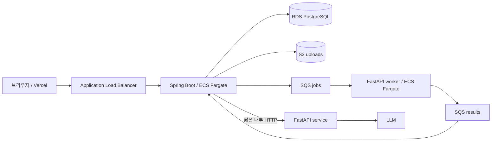

# AWS 개발 환경 아키텍처

## 목표

프런트엔드는 현재 Vercel을 유지하고 Spring Boot, FastAPI, PostgreSQL, 파일 저장과 비동기 작업을 AWS에 배치합니다. 외부 요청은 Spring Boot만 받고 FastAPI와 RDS는 private network에 둡니다.

## 네트워크

- 2개 Availability Zone을 사용합니다.
- public subnet에는 ALB와 dev용 단일 NAT Gateway를 둡니다.
- private app subnet에는 Spring Boot와 FastAPI ECS task를 둡니다.
- isolated DB subnet에는 RDS PostgreSQL을 둡니다.
- 외부에서 RDS와 FastAPI로 직접 접근할 수 없습니다.
- dev는 비용 절감을 위해 NAT Gateway 하나를 공유합니다. 운영 환경의 가용성 정책은 별도로 결정합니다.

## 데이터 흐름

1. Spring Boot가 업로드를 검사하고 S3에 원본을 저장합니다.
2. Spring Boot가 업로드와 작업 상태를 RDS에 `PROCESSING`으로 기록합니다.
3. 긴 작업은 식별자와 S3 key만 SQS job message로 전달합니다.
4. FastAPI는 S3 원본과 RDS 계산용 view를 읽어 계산합니다.
5. FastAPI는 결과 message를 SQS result queue에 발행합니다.
6. Spring Boot가 결과를 검증하고 RDS에 저장한 뒤 상태를 `DONE` 또는 `FAILED`로 바꿉니다.

SQS message에는 원본 파일, 비밀번호, 개인정보와 장기 presigned URL을 넣지 않습니다. `jobId`, `uploadFileId`, `storageKey`, `warehouseId`, `contractVersion`만 전달합니다.

## 배포 책임

- 이 저장소는 ECS cluster/service 기반, IAM, network와 공통 자원을 관리합니다.
- `ipgo-server`와 `ipgo-ai`는 Docker image를 만들고 ECR에 push합니다.
- 애플리케이션 배포는 기존 ECS service의 task revision을 갱신합니다.
- dev 환경 통합 검증 후에만 production 구성을 추가합니다.
